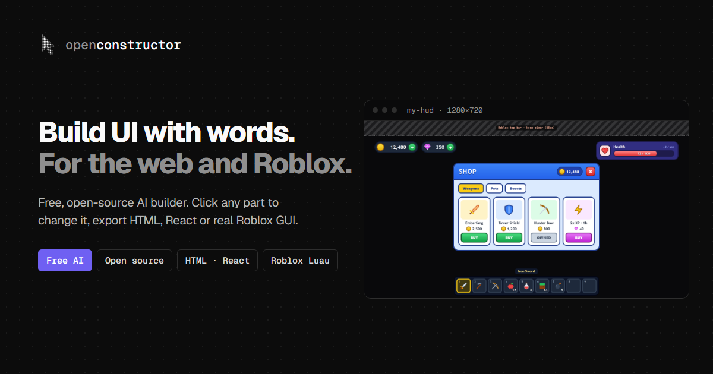
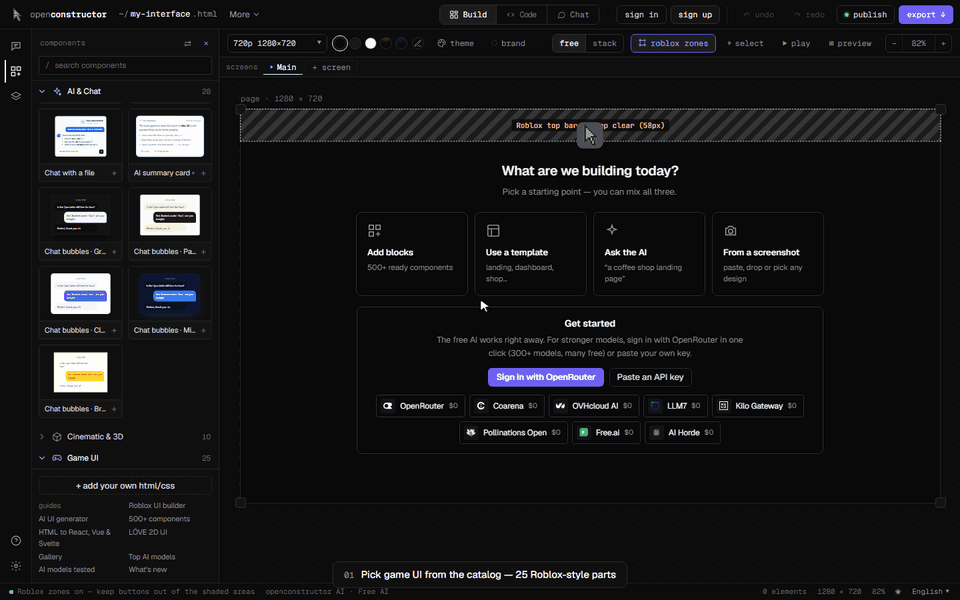

<p align="center"><a href="https://openconstructor.pw"></a></p>

<h1 align="center">openconstructor</h1>

<p align="center">Build interfaces with words and blocks — an open-source, in-browser AI interface builder.</p>

<p align="center"><a href="https://openconstructor.pw"><b>openconstructor.pw</b></a> — try it live</p>

<p align="center"><a href="https://github.com/Kuloka/openconstructor/stargazers"></a> <a href="LICENSE"></a></p>

<p align="center">If openconstructor saves you time, a ⭐ helps other people find it.</p>

<p align="center"><a href="https://openconstructor.pw/roblox-ui-builder">Roblox UI builder</a> · <a href="https://openconstructor.pw/ai-ui-generator">AI UI generator</a> · <a href="https://openconstructor.pw/components">500+ components</a> · <a href="https://openconstructor.pw/html-to-react-vue-svelte">HTML to React / Vue / Svelte</a> · <a href="https://openconstructor.pw/love2d-ui">LÖVE 2D UI</a> · <a href="https://openconstructor.pw/gallery">Gallery</a></p>

<p align="center"></p>

---

Describe a page, an app or a game UI, and AI builds it on a canvas. Change any part by clicking it, then export plain HTML, React / Vue / Svelte, or real Roblox GUI instances. It runs in the browser, it's free, and the AI works without a key.

## Features

**Build with AI**
- **AI assistant** — free out of the box: 3 generations a day without an account, 20 when signed in. Or connect your own key: OpenRouter in one click, and 120+ providers (Anthropic, OpenAI, Gemini, Groq, DeepSeek, Mistral…), some of them with no key at all. Keys stay in your browser.
- **Agent team** — a page is planned by an "architect" and built section by section in parallel. The studio checks the result for overlapping parts and sends them back to fix, and looks things up on the web before writing about anything current.
- **Select & edit** — press **Select** (or `V`), click any part of the page and say what to change: only that part is rewritten. Or open its styles and tweak colors, size, spacing, images and animations by hand.
- **AI permissions** (like opencode) — allow / ask / deny for JavaScript on pages, Google Fonts and big rewrites. "Ask" shows a question in the chat: allow once, always, or no.
- **Paste a screenshot** to rebuild it, or attach your logo, photos and text files to a request. Sites get real photos instead of grey boxes.
- **3D** — live 3D objects on pages (chrome, glass, gold…) and full 3D scenes you can download as **.glb**.

**Apps with data**
- **Mini-apps** — calculators, quizzes, trackers, small games with working JavaScript, in a sandbox without network.
- **`oc.db`** — apps can save and read records: guestbooks, leaderboards, polls, waitlists, orders (`{ private: true }` — only the author can read those). In the editor the data stays in your browser; on a published page it goes to Supabase. See them in **App data**.
- **Code workspace** — files, live preview, console, and errors sent to the AI to fix automatically.

**Roblox**
- **Game UI** — 25 HUD components (shop, hotbar, inventory, health bar, daily rewards…) and 5 full screens, a Roblox safe-zone overlay, every phone and screen size.
- **Export to Studio** — a Luau LocalScript (pixel or scale mode: `UDim2.fromScale`, `TextScaled`, `UIAspectRatioConstraint`), or a drag-and-drop **.rbxmx** model with named buttons and click handlers. You get real Frames, TextLabels, TextButtons, UICorner, UIStroke and UIGradient.
- **Studio sync** ([guide](https://openconstructor.pw/roblox-ui-builder)) — install the [plugin](public/roblox/openconstructor-sync.lua), press *Export → Sync to Roblox Studio* and paste the code: the UI lands in StarterGui. *Live* mode re-syncs on every change and keeps your edited button scripts.

**Canvas and export**
- **Component catalog** — 500+ components in 14 sections, all plain HTML + CSS.
- **Free-form canvas** — drag, pan, zoom, multi-select, align and distribute, smart guides. Screens & prototypes: link a button to `#screen`.
- **Publish & share** — a public link in one click, your own domain, forms that e-mail you, a community gallery with remix, version history.
- **Export anywhere** — HTML, static site .zip, Vite + React project, React, Vue, Svelte, Roblox, LÖVE 2D. AI-assisted ports to Flutter, SwiftUI, Jetpack Compose and Tailwind.
- **Plain Chat mode** — a regular chat with any connected model, with web search.

**Safe by design**
- Every element renders in a sandboxed iframe. Pages have no scripts; apps run scripts on an opaque origin with one network door only — `oc.db` to `/api/db/`.

## Quick start

```bash
git clone https://github.com/Kuloka/openconstructor.git
cd openconstructor
npm install
npm run dev
```

Open http://127.0.0.1:5173. Press `?` in the editor for a quick tour.

The built-in free AI works right away. For more, click the gear icon and connect a provider: OpenRouter signs you in with one click, and Google Gemini and Groq give free keys.

For published apps to save data with `oc.db`, run `supabase/appdata.sql` once in the Supabase SQL editor (see [SETUP.md](SETUP.md)).

## Configuration (optional)

Copy `.env.example` to `.env.local`:

| Variable | Purpose |
|---|---|
| `VITE_SUPABASE_URL`, `VITE_SUPABASE_ANON_KEY` | enable accounts (Google, GitHub, email) |
| `VITE_DONATE_URL` | link for the "support" button |
| `VITE_CRYPTO_WALLETS` | `coin|network|address;…` — public wallet addresses for donations |

Without these, the app works fully, just without accounts.

## Build & deploy

```bash
npm run build   # output in dist/
```

`npm run deploy` builds and uploads to Cloudflare (config in `wrangler.jsonc`). `dist/` is a plain static site, so Netlify, Vercel or GitHub Pages work too.

## Stack

Vite · vanilla JS editor · React 19 for the welcome screen and chat input · Supabase Auth

## Contributing

Issues and pull requests are welcome. New catalog components go in `presets*.js`: self-contained HTML + CSS, a unique class prefix, no scripts. Before a PR, run `npm test` (unit) and `npm run test:e2e` (headless Chrome, the AI is faked).

## License

[MIT](LICENSE). Third-party code is listed in [THIRD_PARTY_NOTICES.md](THIRD_PARTY_NOTICES.md).
