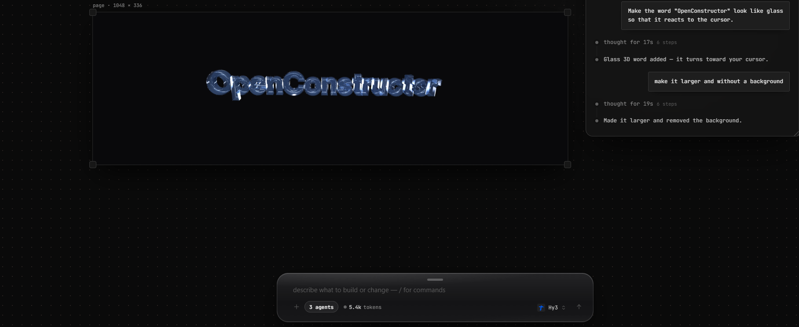

That's a real 3D word made of glass. It's rendered live in WebGL, it turns toward your cursor, and an AI put it on the page from one sentence: *"Make the word OpenConstructor look like glass so that it reacts to the cursor."*

Getting there took a week of things breaking in ways I didn't expect. Here are the four that taught me the most, with the fixes.

Some context first. [openconstructor](https://openconstructor.pw) is a free, open-source page builder. You describe what you want, AI agents build it on a canvas, and you export plain HTML. The AI never writes WebGL. It writes one token:

```html

```

A small trusted runtime turns that token into a live 3D object: three.js, a font, materials and studio light. I'll explain why it's a token and not a three.js scene at the end, because the first version taught me that the hard way.

---

## 1. Glass on a transparent canvas comes out as milky plastic

The obvious approach is `MeshPhysicalMaterial` with `transmission: 1`, real refraction, done. On a transparent canvas, this is what you get: a white, frosted, plastic-looking letter.

The reason is simple once you see it. **Refraction needs something behind the object to bend**, and a WebGL canvas can't see the DOM behind it. three.js renders what's behind the glass into a separate buffer first, and on a transparent canvas there's nothing in it. So the glass "refracts" an empty buffer.

So I stopped trying to refract the page and looked at how glass actually looks on a dark website. The body is basically invisible, and what you see is **the light it catches**: thin streaks on the edges, a bright rim and the back faces glinting through.

So the glass material draws only light, and *adds* it to whatever is under the canvas:

```js
Object.assign(material, {
  color: tint.clone().multiplyScalar(0.025), // almost no body
  metalness: 0, roughness: 0.02, envMapIntensity: 2.4, clearcoat: 1,
  transparent: true, depthWrite: false,
  blending: THREE.CustomBlending,
  blendEquation: THREE.AddEquation,
  blendSrc: THREE.OneFactor,  blendDst: THREE.OneFactor,   // colour: add light
  blendSrcAlpha: THREE.ZeroFactor, blendDstAlpha: THREE.OneFactor, // alpha: untouched
});
```

The alpha trick is the whole point. The canvas is premultiplied, so a pixel with colour but **alpha 0** composites as `page + colour`. The real page background shows through the letter, and the highlights sit on top of it, like real glass.

Two more things made it read as glass instead of a ghost:

- **A light environment built for glass.** A soft "photo studio" environment makes chrome gorgeous, but it washes flat glass faces in even grey. Glass needs a black room crossed by thin strip lights, so every bevel catches a crisp line. I build it as a tiny three.js scene of emissive planes and feed it to `PMREMGenerator.fromScene()`.
- **Draw the inside too.** A second mesh with `side: BackSide` and dimmer reflections gives you the inner walls, and that's what makes it look thick.

## 2. A `<canvas>` in a document without scripts has no size and paints nothing

On the editor canvas, every element lives in its own sandboxed iframe **without `allow-scripts`**. AI-written code should never run in the editor. My plan was to let the editor (the parent page) grab the iframe's `<canvas>` and render WebGL into it from outside. Same-origin, so `contentDocument` works.

The first result was a blank square. I tried 2D next and drew a big red rectangle into that canvas from the parent: also nothing.

It's in the spec. When scripting is disabled in a document, **`<canvas>` represents its fallback content.** It stops being a replaced element: no intrinsic 300×150 size, no bitmap painted, just an empty inline box. It doesn't matter that another document is drawing into it.

That also explained a second bug users hit: *"the 3D model appears while it's being built, then disappears."* While the AI streams, the element is an `` (visible). The final element is a `<canvas>` with no width set, which collapsed to 0×0.

The fixes:

- The editor puts **its own canvas on top** of the element, at the same spot, inside the element's node so it moves and zooms with it, and renders there.
- The canvas inside the frame gets a size from CSS with **zero specificity**, so any width the AI wrote still wins:

```css
:where(canvas[data-oc-model]) { display: inline-block; width: 640px; vertical-align: middle; }
```

```html
<canvas data-oc-model="text OpenConstructor glass" width="640" height="100"
        style="aspect-ratio: 640/100; background: url('data:image/webp…') center/contain no-repeat"></canvas>
```

The `background` is a pre-rendered still of the same object. It's what you see in exports where scripts are off, in thumbnails, and for the first frame before WebGL starts.

## 3. The browser silently kills your oldest WebGL contexts

Chrome keeps around **16 WebGL contexts per tab**. Create the 17th and it drops the oldest with a `webglcontextlost`, which you won't notice unless you listen for it.

I hit it because every still picture (those poster backgrounds) is rendered with a short-lived renderer, and a page with several 3D objects rendered them all at once, while the live ones were already running. The result was live objects going blank at random.

The fix is boring, and that's fine: render stills **one at a time** through a promise queue, and cap live objects in the editor.

```js
let queue = Promise.resolve();
export function renderModel(query, size = 640) {
  const job = queue.then(() => renderStill(query, size));
  queue = job.catch(() => {});
  return job;
}
```

## 4. Long words: fit the box, not the sphere

My camera framed objects by their bounding **sphere**, which is perfect for a torus or a letter. For a 15-letter word, the sphere's diameter is the word's width, so the word ended up a thin line in the middle of the picture.

The fix has three parts:

- **Fit per axis**: `distance = max(height·0.62 / tan(fov/2), width·0.58 / (tan(fov/2)·aspect))`.
- **Refit when the canvas changes shape**: `ResizeObserver` → `fit(w / h)`. Otherwise responsive layouts crop the word.
- **A long lens for wide objects** (FOV 14° instead of 30°). The ends of the word stop bending into perspective when it turns toward the cursor, and it turns less (±9° instead of ±20°) so it stays readable.

---

## Why the AI writes a token, not a 3D scene

The first version let the model describe 3D scenes as JSON: boxes, spheres, tori and so on. Ask it for "a 3D letter D" and you get a box glued to half a torus. Technically a D, visually a crime.

The lesson I keep relearning with LLMs: **give the model a high-level vocabulary and do the precise part deterministically.** "`model:letter D chrome`" is impossible to get wrong. A real font outline, bevels, materials and lighting live in ~300 lines of code I control. The AI picks *what*; the runtime decides *how*.

The same idea keeps the published pages safe. The runtime is one self-contained file (three.js + font, ~163 KB gzipped, no network), and published pages get a CSP that allows **that one script and nothing else**. The AI's own code still never runs.

---

The editor is free and open source. You can try making your own glass word at [openconstructor.pw](https://openconstructor.pw) (no sign-up for the first tries), and the code is on [GitHub](https://github.com/Kuloka/openconstructor).

**A question for the three.js people:** is there a cleaner way to fake refraction when the canvas can't see the DOM behind it? Additive highlights look right on dark pages, but on a light background glass should *darken* things a little, and I haven't found a nice way to do both. I'd love to hear how you'd approach it.
